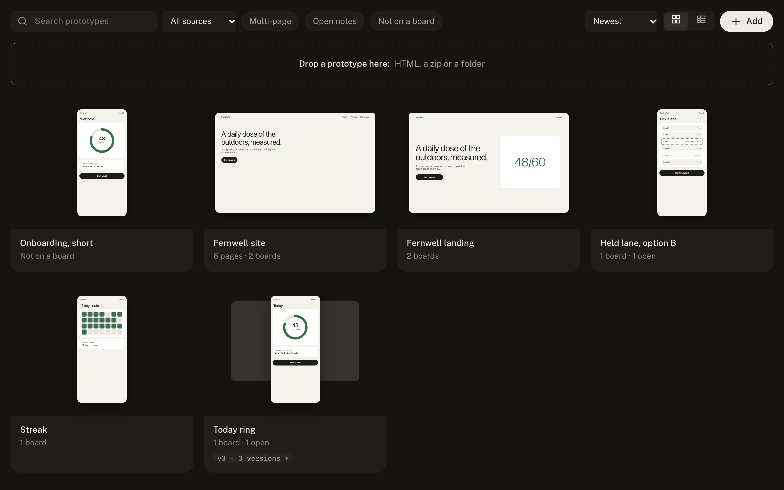

# can●n

Canon is a board in your browser for the prototypes your coding agent builds.
You drop in HTML, zips or folders, compare versions side by side, and nothing
is uploaded.



## Try it

Open [Canon](https://jamesmadson.github.io/canon/app/). It opens with a sample
project.

## Connect your agent

Claude Code:

```bash
claude mcp add canon --scope user -- npx -y usecanon mcp
```

Codex, in `~/.codex/config.toml`:

```toml
[mcp_servers.canon]
command = "npx"
args = ["-y", "usecanon", "mcp"]
```

Cursor, in `.cursor/mcp.json`:

```json
{ "mcpServers": { "canon": { "command": "npx", "args": ["-y", "usecanon", "mcp"] } } }
```

1. Add the server with the line for your agent, then restart the agent.
2. Open Canon in your browser.
3. Ask your agent to pair with Canon, and approve the link it gives you.

The server runs on your machine and talks only to the Canon tab you have
open. More in [cli/README.md](cli/README.md).

## Skills

Canon also ships three Claude Code plugins of its own:

- **graft** maps a Claude Code session as a branch diagram: your turns as the
  trunk, subagents as forks, compactions as diamonds.
- **strata** keeps a record of what users actually said, in dated layers,
  under pseudonyms, with verbatim kept apart from interpretation.
- **deter** is a review that removes: every finding priced against the
  surface's job, one thing kept, at most one thing missing.

```
/plugin marketplace add jamesmadson/canon
```

Then install `graft`, `strata` or `deter`. Sources are in `plugin/`.

## Run it locally

```bash
npm install
npm run dev
```

The site runs at `http://localhost:4321/canon/` and the app at
`http://localhost:4321/canon/app/`. The bare root 404s because of the `/canon`
base path.

- `npm run build`: production build to `dist/`
- `npm run preview`: serve the build locally
- `npm test`: the Vitest suite
- `npm run check`: Astro type-check

The app lives in `src/app/` (Preact and htm, no build-time JSX) with its
service worker at `public/app-sw.js`. The `usecanon` package in `cli/` is the
MCP server and has no runtime dependencies.

## Feedback

Tell us what broke or what you wished it did at
[github.com/jamesmadson/canon/issues](https://github.com/jamesmadson/canon/issues).

## License

MIT. See [LICENSE](LICENSE).
