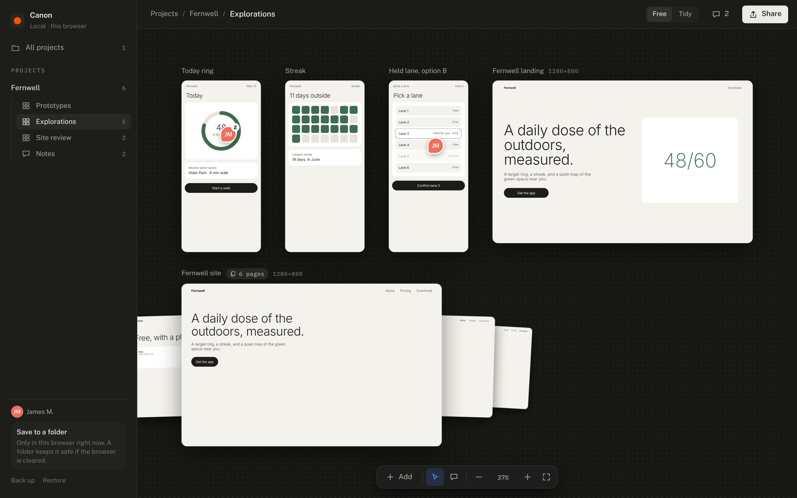
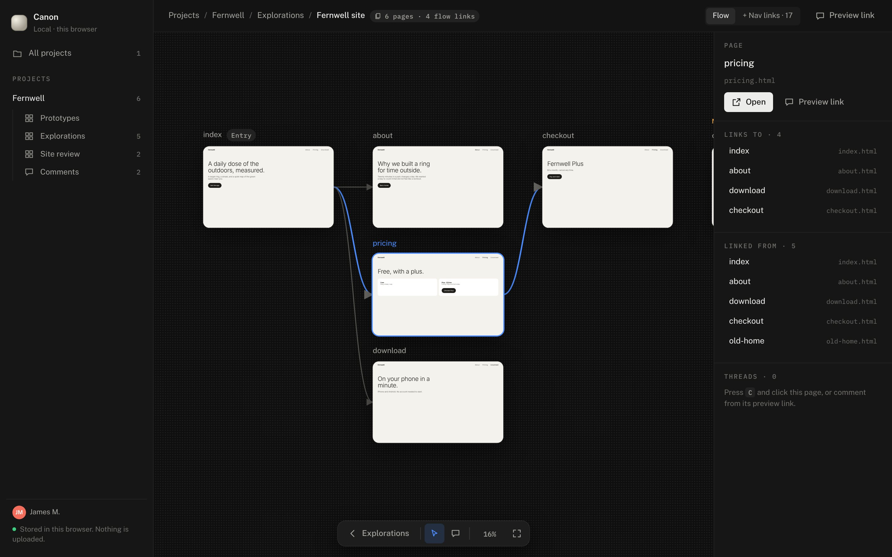

# can●n

**Every prototype, from every tool, in one place.**

Claude Code, v0, Lovable, Figma Make, a branch, a zip. Your prototypes live
everywhere. Canon puts them on one shelf you can see, open and share. It runs
in your browser or installs as an app, and nothing is uploaded.

**[Try it](https://jamesmadson.github.io/canon/app/)** ·
[Site](https://jamesmadson.github.io/canon/) ·
[Decisions](docs/DECISIONS.md)



---

## What it does

- **One library.** Drag in HTML files, zipped builds and whole folders. Or
  link a repo folder on your machine, or several, and they stay current.
  Search, sort and filter across all of it.
- **Versions stack.** Rounds of the same prototype stack together, newest on
  top, one marked current: `onboarding`, `onboarding v2` and
  `Onboarding-final` land in one stack, and so do every Vercel or Netlify
  preview of one project. Add a version from a prototype's panel and it takes
  the old one's spot on the board.
- **⌘K.** Open any prototype, in any project, from anywhere. Enter opens the
  current version.
- **Boards.** Lay prototypes out on a canvas. One prototype can sit on as
  many boards as it needs.
- **A map for anything with more than one page.** Hover a multi-page
  prototype and its other pages tease out from behind it. Open it and Canon
  reads its HTML: every page, the links between them, and the pages nothing
  points to anymore.
- **Notes.** Pin a note to yourself on a screen, a page or the canvas: what
  changed, what to try next, which version is current.
- **Install it.** In Chrome, Edge or Arc, use the Install button in the
  sidebar for its own window and a Dock or taskbar icon. In Safari, File, then
  Add to Dock. It works offline.



## How it works

Canon is the index, not the source of truth. Your work stays where it was
made; Canon points at it and shows it.

Canon works from your browser's storage (IndexedDB), and a service worker
serves dropped-in prototypes from it, so a zip from v0 and a folder from Claude
Code open the same way. Nothing leaves your machine, and Canon collects no
usage data (see D-40 in the decision log).

Browser storage can be cleared, so Canon keeps a durable copy as plain files:

- **A Canon folder** (Chrome, Edge, Arc). Choose a folder once and Canon
  writes `canon.json` plus every prototype's files there a moment after each
  change. If the browser is ever cleared, choose "Open your Canon folder" and
  everything comes back. Back the folder up like any other.
- **A backup file** (every browser). "Back up" saves one `.canon` file;
  "Restore" brings it back. Restoring merges; it never deletes.

Sharing with colleagues by email is designed but not built. It needs a small
hosted layer and waits until a team asks for it.

## Skills

Canon also ships three Claude Code plugins of its own:

- **graft** maps a Claude Code session as a branch diagram: your turns as the
  trunk, subagents as forks, compactions as diamonds.
- **strata** keeps a record of what users actually said, in dated layers,
  under pseudonyms, with verbatim kept apart from interpretation.
- **deter** is a review that removes: every finding priced against the
  surface's job, one thing kept, at most one thing missing.

```
/plugin marketplace add jamesmadson/canon
```

Then install `graft`, `strata` or `deter`. Sources are in `plugin/`.

---

## Development

```bash
npm install
npm run dev
```

The site runs at `http://localhost:4321/canon/` and the app at
`http://localhost:4321/canon/app/`. The bare root 404s because of the `/canon`
base path.

- `npm run build`: production build to `dist/`
- `npm run preview`: serve the build locally (the app's service worker and
  install flow behave like production here)
- `npm test`: the Vitest suite (app, content, marketplace, CLI)
- `npm run check`: Astro type-check

The app lives in `src/app/` (Preact and htm, no build-time JSX) with its
service worker at `public/app-sw.js`. Homepage screenshots come from the
sample project via `scripts/capture-app-shots.mjs`; every name in them is
invented.

The CLI in `cli/` indexes prototype branches in a repo. It isn't published to
npm yet; the package name is still open.

## Deploying

GitHub Pages, via `.github/workflows/deploy.yml`, on every push to `main`.

The `/canon` base path is set in two places. Change both together:

- `astro.config.mjs` (`site` and `base`)
- `src/styles/global.css` (`@font-face` URLs, which plain CSS can't read from
  Astro)

## License

MIT. See [LICENSE](LICENSE).
